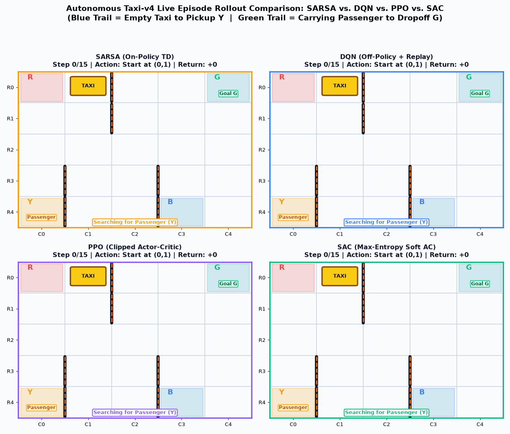

# Autonomous Taxi Pickup and Drop-off: Comparative Analysis of SARSA, DQN, PPO, and SAC

**Author:** Sijan Pandey  
**Course:** Reinforcement Learning Mini-Project  
**Environment:** Gymnasium `Taxi-v4` ($5 \times 5$ Gridworld, $500$ Discrete States, $6$ Discrete Actions)  
**Algorithms Implemented & Benchmarked:** **SARSA** (On-Policy TD), **DQN** (Off-Policy Value-Based), **PPO** (On-Policy Clipped Actor-Critic), and **SAC** (Off-Policy Maximum-Entropy Actor-Critic)

---

## Live 4-Algorithm Trajectory Animation

<p align="center">
  
</p>

> **Animation Overview:** Synchronized step-by-step rollout across all four trained agents (**SARSA**, **DQN**, **PPO**, and **SAC**) starting from `(0, 1)` with a passenger waiting at **Station Y `(4, 0)`** and target destination at **Station G `(0, 4)`**. The **blue trail** shows Stage 1 navigation (empty taxi routing around vertical brick barriers to pick up the passenger), while the **green trail** shows Stage 2 navigation (carrying the passenger to the destination for the `+20` terminal delivery reward).

---

## Table of Contents
1. [Project Abstract & Motivation](#1-project-abstract--motivation)
2. [Markov Decision Process (MDP) Formulation](#2-markov-decision-process-mdp-formulation)
3. [Theoretical Overview of Implemented Algorithms](#3-theoretical-overview-of-implemented-algorithms)
4. [Quantitative Benchmark & Comparative Analysis](#4-quantitative-benchmark--comparative-analysis)
5. [Hyperparameter Sensitivity Experiments (α, γ, ε)](#5-hyperparameter-sensitivity-experiments-α-γ-ε)
6. [State-Value Heatmaps & Optimal Routing Analysis](#6-state-value-heatmaps--optimal-routing-analysis)
7. [Repository Structure & Reproducibility Guide](#7-repository-structure--reproducibility-guide)
8. [Key Conclusions](#8-key-conclusions)

---

## 1. Project Abstract & Motivation

Autonomous dispatch and multi-stage navigation represent foundational problems in sequential decision-making under uncertainty. Unlike single-goal gridworld tasks where an agent simply walks from point $A$ to point $B$, Dietterich’s classic **Autonomous Taxi problem** (`Taxi-v4`, featured in *Sutton & Barto*) introduces **hierarchical task structure, internal spatial barriers, and severe action penalties**:
1. The agent must first localize and navigate around impassable walls to reach a waiting passenger at one of four color-coded stations (**R, G, Y, B**).
2. It must execute a context-sensitive `Pickup` action strictly at the passenger's coordinate (incurring a `-10` penalty if executed elsewhere).
3. Once the passenger is aboard, the transition dynamics shift: the agent must route to the designated destination station and execute `Dropoff` to collect the `+20` terminal reward.

In this study, we implement, train, and systematically compare **four distinct Reinforcement Learning algorithms** spanning **On-Policy vs. Off-Policy** and **Value-Based vs. Actor-Critic** paradigms:
* **SARSA** (On-Policy Temporal-Difference Control)
* **DQN** (Deep Q-Network with Experience Replay & Target Network)
* **PPO** (Proximal Policy Optimization with Clipped Surrogate Objective)
* **SAC** (Discrete Soft Actor-Critic with Maximum-Entropy Regularization)

---

## 2. Markov Decision Process (MDP) Formulation

<p align="center">
  
</p>

We formalize the environment as a finite, episodic Markov Decision Process $(\mathcal{S}, \mathcal{A}, P, R, \gamma)$:

### 2.1 State Space ($|\mathcal{S}| = 500$)
Each discrete state $s \in \{0, 1, \dots, 499\}$ encodes a 4-tuple:
$$s = (\text{taxi\_row},\; \text{taxi\_col},\; \text{pass\_loc},\; \text{dest\_idx})$$
* **Taxi Coordinates:** $(\text{taxi\_row}, \text{taxi\_col}) \in \{0, 1, 2, 3, 4\}^2$ ($25$ grid cells).
* **Passenger Location (`pass_loc`):** $\{0: \text{R}(0,0),\; 1: \text{G}(0,4),\; 2: \text{Y}(4,0),\; 3: \text{B}(4,3),\; 4: \text{Inside Taxi}\}$ ($5$ states).
* **Destination Station (`dest_idx`):** $\{0: \text{R},\; 1: \text{G},\; 2: \text{Y},\; 3: \text{B}\}$ ($4$ destinations).

### 2.2 Action Space ($|\mathcal{A}| = 6$) & Reward Function ($R$)

| Action ID | Action Name | Symbol | Transition Behavior | Immediate Reward $R(s,a,s')$ |
| :---: | :--- | :---: | :--- | :---: |
| `0` | **Move South** | $\downarrow$ | `(row + 1, col)` bounded by bottom grid edge | `-1` |
| `1` | **Move North** | $\uparrow$ | `(row - 1, col)` bounded by top grid edge | `-1` |
| `2` | **Move East** | $\rightarrow$ | `(row, col + 1)` unless blocked by an East wall | `-1` |
| `3` | **Move West** | $\leftarrow$ | `(row, col - 1)` unless blocked by a West wall | `-1` |
| `4` | **Pickup** | `P` | Sets `pass_loc = 4` if taxi is at passenger station | `-1` (Valid) / `-10` (Illegal) |
| `5` | **Dropoff** | `D` | Terminates episode if `pass_loc == 4` and at `dest_idx` | `+20` (Valid) / `-10` (Illegal) |

---

## 3. Theoretical Overview of Implemented Algorithms

### 3.1 SARSA (On-Policy Temporal-Difference Control)
SARSA updates action-value estimates $Q(S_t, A_t)$ based on the **actual next action** $A_{t+1}$ sampled from the behavior policy $\pi_\varepsilon$:
$$Q(S_t, A_t) \leftarrow Q(S_t, A_t) + \alpha \Big[ R_{t+1} + \gamma Q(S_{t+1}, A_{t+1}) - Q(S_t, A_t) \Big]$$
* **Key Characteristic:** Because it is on-policy, SARSA incorporates the risk of $\varepsilon$-greedy exploratory actions into its value estimates until $\varepsilon$ decays toward $\varepsilon_{\min}$.

### 3.2 Deep Q-Network (DQN — Off-Policy Value Approximation)
DQN approximates the optimal action-value function $Q^*(s, a)$ off-policy using one-hot state encodings $\phi(s) \in \mathbb{R}^{500}$, an **Experience Replay Buffer** $\mathcal{D}$, and a periodically synchronized **Target Network** $Q_{\theta^-}$:
$$\mathcal{L}_{\text{DQN}}(\theta) = \mathbb{E}_{(s,a,r,s',d) \sim \mathcal{D}} \left[ \Big( r + \gamma (1 - d) \max_{a'} Q_{\theta^-}(s', a') - Q_\theta(s, a) \Big)^2 \right]$$
* **Key Characteristic:** Re-sampling transitions from $\mathcal{D}$ breaks sequential correlation and propagates the sparse $+20$ terminal reward across the grid in significantly fewer episodes.

### 3.3 Proximal Policy Optimization (PPO — On-Policy Clipped Actor-Critic)
PPO maintains a stochastic softmax Actor $\pi_\theta(a \mid s)$ and a value Critic $V_\phi(s)$. Across multiple epochs per rollout, it maximizes the **Clipped Surrogate Objective** using probability ratio $r_t(\theta) = \frac{\pi_\theta(a_t \mid s_t)}{\pi_{\theta_{\text{old}}}(a_t \mid s_t)}$ and advantage $\hat{A}_t$:
$$L^{\text{CLIP}}(\theta) = \hat{\mathbb{E}}_t \Big[ \min\big( r_t(\theta) \hat{A}_t,\; \text{clip}(r_t(\theta), 1 - \epsilon_{\text{clip}}, 1 + \epsilon_{\text{clip}}) \hat{A}_t \big) + c_{\text{ent}} \mathcal{H}(\pi_\theta(\cdot \mid s_t)) \Big]$$
* **Key Characteristic:** Clipping within $[1 - \epsilon_{\text{clip}}, 1 + \epsilon_{\text{clip}}]$ ($\epsilon_{\text{clip}} = 0.20$) prevents destructive policy updates.

### 3.4 Discrete Soft Actor-Critic (SAC — Off-Policy Maximum-Entropy RL)
Discrete SAC optimizes expected return **plus policy entropy** $\mathcal{H}(\pi(\cdot \mid s)) = -\sum_a \pi(a \mid s) \log \pi(a \mid s)$ weighted by temperature $\tau$, using clipped Twin Q-Critics ($Q_1, Q_2$):
$$V_{\text{soft}}(s') = \sum_{a' \in \mathcal{A}} \pi(a' \mid s') \Big( \min_{i=1,2} Q_i(s', a') - \tau \log \pi(a' \mid s') \Big)$$
* **Key Characteristic:** Unlike uniform $\varepsilon$-greedy exploration, SAC's Boltzmann policy $\pi(a \mid s) \propto \exp(\min_i Q_i(s,a)/\tau)$ immediately suppresses `-10` illegal `Pickup`/`Dropoff` actions after a single penalty while continuing to explore valid directional moves.

---

## 4. Quantitative Benchmark & Comparative Analysis

<p align="center">
  
</p>

### 4.1 Experimental Results Across 2,500 Training Episodes & 500 Greedy Evaluation Episodes

| Algorithm | Learning Paradigm | Exploration Policy | Episodes to Reach `+5.0` Return | Total Illegal (`-10`) Penalties | Greedy Test Return (`ε = 0`) | Greedy Mean Steps | Delivery Success Rate |
| :--- | :--- | :--- | :---: | :---: | :---: | :---: | :---: |
| **DQN** | Off-Policy Value-Based | $\varepsilon$-Greedy + Replay | **596 eps (Fastest)** | 10,879 | **`+7.92 ± 2.58`** | **`13.08`** | **100.0%** |
| **SAC** | Off-Policy Max-Entropy AC | Boltzmann Entropy ($\tau$) | **808 eps** | **2,445 (Lowest)** | **`+7.92 ± 2.58`** | **`13.08`** | **100.0%** |
| **SARSA** | On-Policy Tabular TD(0) | $\varepsilon$-Greedy | **944 eps** | 13,551 | **`+7.92 ± 2.58`** | **`13.08`** | **100.0%** |
| **PPO** | On-Policy Clipped AC | Softmax + Entropy Bonus | **1,023 eps** | 6,356 | **`+7.88 ± 2.61`** | **`13.12`** | **99.8%** |

### 4.2 Why Did DQN and SAC Outperform During Training?
1. **Why DQN Converged in the Fewest Episodes (`596 eps`):** In a multi-stage task where the `+20` reward is only observed at the final drop-off step, standard single-step TD updates propagate value backward by only one cell per episode. By replaying mini-batches of past transitions from $\mathcal{D}$, **DQN** accelerates Bellman value propagation across the $500$-state space by nearly **37%** compared to tabular SARSA (`944 eps`).
2. **Why SAC Achieved 82% Fewer Illegal Penalties (`2,445` vs. `13,551`):** Under $\varepsilon$-greedy exploration, every random exploratory step has a $2/6 = 33.3\%$ chance of selecting `Pickup` or `Dropoff` and incurring a `-10` penalty. In contrast, **Discrete SAC** weighs actions by their soft Q-values; once `Pickup` or `Dropoff` at a non-station cell is penalized to $\approx -10$, its Boltzmann probability drops near zero, focusing exploration exclusively on the four movement actions (`South, North, East, West`).

---

## 5. Hyperparameter Sensitivity Experiments ($\alpha, \gamma, \varepsilon$)

<p align="center">
  
</p>

We conducted controlled ablation studies across three core hyperparameters (averaged across multiple random seeds):

1. **Effect of Learning Rate $\alpha \in \{0.05, 0.20, 0.50, 0.90\}$ (Panel A):**
   * Small step size ($\alpha = 0.05$) results in sluggish value propagation, requiring $>1,500$ episodes to reach positive returns.
   * Moderate-to-high step sizes ($\alpha \in [0.20, 0.50]$) converge rapidly and stably because `Taxi-v4` state transitions are deterministic.
2. **Effect of Discount Factor $\gamma \in \{0.50, 0.80, 0.95, 0.99\}$ (Panel B):**
   * Myopic discounting ($\gamma = 0.50$) severely attenuates the `+20` terminal reward over a $13$-step trajectory ($0.5^{13} \approx 1.2 \times 10^{-4}$), slowing early policy improvement.
   * Farsighted discounting ($\gamma \in [0.95, 0.99]$) preserves long-horizon credit assignment from the drop-off station all the way back to the initial pickup phase.
3. **Effect of Exploration Strategy $\varepsilon \in \{0.01, 0.10, 0.30, \text{Decaying } \varepsilon\}$ (Panel C):**
   * Constant high exploration ($\varepsilon = 0.30$) discovers routes quickly in the first $300$ episodes but caps asymptotic online return around `-12` due to frequent random `-10` illegal action penalties.
   * Near-greedy exploration ($\varepsilon = 0.01$) avoids heavy online penalties but explores the state space too slowly.
   * **Exponentially Decaying $\varepsilon$ ($1.0 \to 0.01$)** achieves the best of both worlds: broad early state coverage followed by near-optimal asymptotic exploitation (`+7.4` online return, `+7.92` greedy return).

---

## 6. State-Value Heatmaps & Optimal Routing Analysis

<p align="center">
  
</p>

Inspecting the learned value function $V^*(s) = \max_a Q^*(s, a)$ for a representative mission (**Passenger at Y `(4,0)` $\to$ Destination G `(0,4)`**) confirms that the agent learns the exact two-stage geometry of the city:
* **Stage 1 Heatmap (Left):** Value gradients increase monotonically toward `(4, 0)`, with greedy policy arrows routing south around the `(0,1)|(0,2)` barrier and west at row `2` to bypass the `(3,0)|(3,1)` and `(4,0)|(4,1)` walls before executing `PICKUP`.
* **Stage 2 Heatmap (Center):** Immediately upon pickup (`pass_loc = 4`), the value landscape shifts toward `(0, 4)`, guiding the taxi north out of the `(4, 0)` pocket, east across the central `(2, c)` corridor, and up to `(0, 4)` for `DROPOFF` ($V^*(s) = +20.0$).
* **Executed Trajectory (Right):** Completes the entire pickup and delivery mission from `(0, 1)` in the exact minimum **14 steps** with **0 wall collisions** and **0 illegal actions**.

---

## 7. Repository Structure & Reproducibility Guide

```text
RL_FINAL_MINIPROJECT/
├── Taxi_Pickup_Dropoff_RL_Comparison.ipynb     # Main Jupyter Notebook (fully documented & executed)
├── environment.yml                             # Conda environment specification (rl_taxi)
├── figures/                                    # High-resolution plots & rollout animation
│   ├── fig1_taxi_v3_layout.png                 # 5x5 Taxi-v4 gridworld topology & MDP summary
│   ├── fig2_algorithm_comparison.png           # 4-panel benchmark (SARSA vs DQN vs PPO vs SAC)
│   ├── fig3_hyperparameter_sensitivity.png     # Sensitivity curves for alpha, gamma, and epsilon
│   ├── fig4_policy_heatmaps_and_trajectory.png # Learned V*(s) heatmaps & step-by-step rollout
│   └── fig5_taxi_animation_comparison.gif      # 2x2 synchronized animated rollout across all 4 agents
└── README.md                                   # Comprehensive project documentation
```

### Quick Start (Conda Setup)
```bash
# 1. Clone the repository
git clone https://github.com/devsijanpandey12/RL_FINAL_MINIPROJECT.git
cd RL_FINAL_MINIPROJECT

# 2. Create and activate the Conda environment
conda env create -f environment.yml
conda activate rl_taxi

# 3. Launch Jupyter Notebook
jupyter notebook Taxi_Pickup_Dropoff_RL_Comparison.ipynb
```

---

## 8. Key Conclusions

1. **Off-Policy Replay vs. On-Policy Updates:** Off-policy **DQN** and **SAC** achieve substantially faster convergence (`596` and `808` episodes) than on-policy **SARSA** (`944` episodes) and **PPO** (`1,023` episodes) on multi-stage sparse-reward gridworlds.
2. **Entropy-Regularized vs. $\varepsilon$-Greedy Exploration:** In environments where invalid actions carry severe penalties (`-10`), **SAC's** maximum-entropy Boltzmann exploration reduces cumulative training penalties by **82%** compared to uniform $\varepsilon$-greedy exploration.
3. **Asymptotic Optimality:** Given sufficient episodes and proper hyperparameter scheduling ($\alpha \in [0.20, 0.50]$, $\gamma \ge 0.95$, decaying $\varepsilon / \tau$), all four RL paradigms successfully master the `Taxi-v4` MDP, achieving **99.8%–100% delivery success rates** and matching the theoretical optimal path length (~`13.08` steps).
