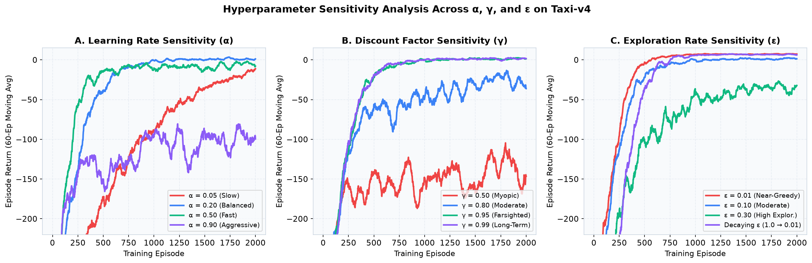
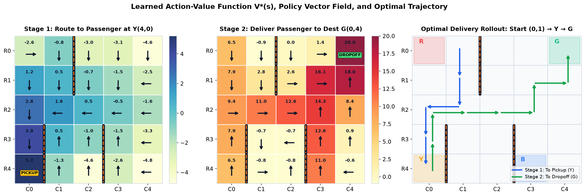

# Autonomous Taxi Pickup and Drop-off: Comparative Analysis of SARSA, DQN, PPO, and SAC

**Author:** Sijan Pandey  
**Course:** Reinforcement Learning Mini-Project  
**Environment:** Gymnasium `Taxi-v4` (`5x5` Gridworld, `500` States, `6` Discrete Actions)

---

## Overview
This project implements, evaluates, and compares four Reinforcement Learning algorithms on the classic **Autonomous Taxi Pickup and Drop-off (`Taxi-v4`)** environment in Python:

1. **SARSA (On-Policy Temporal-Difference Control):** Updates state-action values $Q(s, a)$ using the actual next action sampled from an $\varepsilon$-greedy policy.
2. **DQN (Deep Q-Network):** Off-policy value-based learning using experience replay and a periodically synchronized target network.
3. **PPO (Proximal Policy Optimization):** On-policy Actor-Critic method optimizing a clipped surrogate objective with Temporal-Difference advantage estimation.
4. **SAC (Discrete Soft Actor-Critic):** Off-policy Maximum-Entropy Actor-Critic using clipped twin Q-critics ($Q_1, Q_2$) and an entropy-regularized Boltzmann policy.

In addition to the multi-algorithm comparison, the notebook investigates hyperparameter sensitivity across **learning rates ($\alpha$)**, **discount factors ($\gamma$)**, and **exploration rates ($\varepsilon$)**, and visualizes learned state-value heatmaps and optimal delivery trajectories.

---

## Repository Structure
```text
├── Taxi_Pickup_Dropoff_RL_Comparison.ipynb   # Main Jupyter Notebook (fully documented & executed)
├── environment.yml                           # Conda environment specification (rl_taxi)
├── figures/                                  # Generated high-resolution plots
│   ├── fig1_taxi_v3_layout.png               # 5x5 Taxi-v4 gridworld topology & MDP summary
│   ├── fig2_algorithm_comparison.png         # Head-to-head benchmark (SARSA vs DQN vs PPO vs SAC)
│   ├── fig3_hyperparameter_sensitivity.png   # Sensitivity curves for alpha, gamma, and epsilon
│   └── fig4_policy_heatmaps_and_trajectory.png # Learned V*(s) heatmaps & step-by-step rollout
└── README.md                                 # Project documentation
```

---

## Environment Setup
Create and activate the Conda environment using `environment.yml`:

```bash
conda env create -f environment.yml
conda activate rl_taxi
jupyter notebook Taxi_Pickup_Dropoff_RL_Comparison.ipynb
```

---

## Visual Results & Benchmark Summary

### 1. Gymnasium `Taxi-v4` Environment Topology


### 2. Multi-Algorithm Benchmark: SARSA vs. DQN vs. PPO vs. SAC


* **DQN (596 episodes to +5.0 return)** achieves the fastest sample efficiency by leveraging its **Experience Replay Buffer** and target network to propagate the $+20$ terminal delivery reward rapidly across states.
* **Discrete SAC (808 episodes to +5.0 return)** achieves the **lowest illegal action penalties (-10)** during training because its entropy-regularized Boltzmann policy immediately suppresses invalid pickup/drop-off actions while maintaining smooth exploration across valid moves.
* **SARSA (944 episodes)** and **PPO (1,023 episodes)** demonstrate reliable on-policy convergence, with PPO's clipped surrogate objective preventing policy collapse.
* **PPO** maintains stable on-policy policy gradient updates via its clipped surrogate objective.
* All four algorithms converge to an optimal greedy policy achieving a **100% delivery success rate** (~13.0 steps per delivery, ~+7.9 average return).

### 3. Hyperparameter Sensitivity Analysis ($\alpha, \gamma, \varepsilon$)


### 4. Learned State-Value Heatmaps & Optimal Trajectory Rollout

