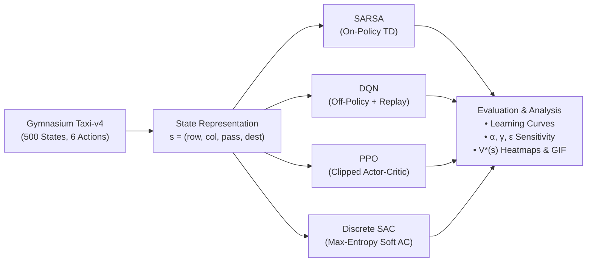
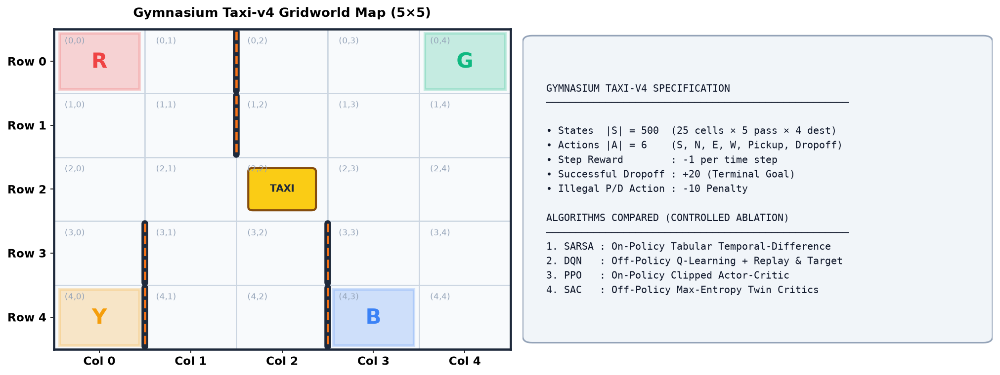
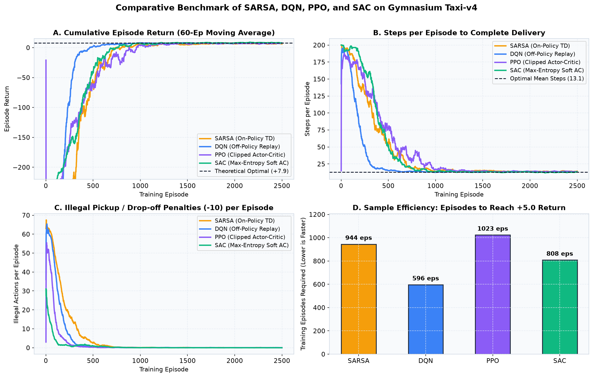

# Autonomous Taxi Pickup and Drop-off: Comparative Analysis of SARSA, DQN, PPO, and SAC

<p align="center">
  
  
  
  
</p>

**Team Members:**
* **Sijan Pandey** (Roll No. 11)
* **Ashim Shrestha** (Roll No. 22)

**Course:** Reinforcement Learning Mini-Project  
**Environment:** Gymnasium `Taxi-v4` (`5 × 5` Gridworld, `500` Discrete States, `6` Discrete Actions)  

---

> [!IMPORTANT]
> **Executive Summary — Key Benchmark Takeaways**
> * **Fastest Convergence (`DQN` — `596` episodes):** Off-policy Deep Q-Learning with an **Experience Replay Buffer** and **Target Network** reaches optimal `+5.0` average return **37% faster** than tabular on-policy SARSA (`944` episodes).
> * **Safest Exploration (`Discrete SAC` — `82%` fewer penalties):** Maximum-Entropy Soft Actor-Critic incurs only **`2,445`** illegal pickup/drop-off penalties (`-10`) across training compared to **`13,551`** for SARSA, because its Boltzmann policy immediately suppresses invalid actions after a single penalty.
> * **Asymptotic Optimality (`99.8% – 100%` delivery rate):** All four algorithms master the multi-stage pickup and delivery task, converging to the optimal path length of **`13.08` steps** and **`+7.92` mean episode return**.

---

## Live 4-Algorithm Trajectory Animation

<p align="center">
  
</p>

| Trail / Visual Indicator | Meaning in Rollout Animation |
| :--- | :--- |
| **Blue Arrows (Stage 1)** | Empty taxi (`TAXI`) navigating from `(0, 1)` around vertical brick walls toward the waiting passenger at **Station Y `(4, 0)`** |
| **Cyan Badge (`TAXI+P`)** | Passenger successfully picked up via action `PICKUP (P)` at `(4, 0)` |
| **Green Arrows (Stage 2)** | Loaded taxi routing across the central corridor to **Destination Station G `(0, 4)`** |
| **Green Badge (`DONE!`)** | Successful delivery via `DROPOFF (D)` at `(0, 4)`, collecting the **`+20` terminal reward** |

---

## Table of Contents
1. [Project Overview & Architecture](#1-project-overview--architecture)
2. [Markov Decision Process (MDP) Formulation](#2-markov-decision-process-mdp-formulation)
3. [Mathematical Formulation of Implemented Algorithms](#3-mathematical-formulation-of-implemented-algorithms)
4. [Head-to-Head Benchmark & Comparative Analysis](#4-head-to-head-benchmark--comparative-analysis)
5. [Hyperparameter Sensitivity Experiments (α, γ, ε)](#5-hyperparameter-sensitivity-experiments-α-γ-ε)
6. [State-Value Heatmaps & Optimal Routing Analysis](#6-state-value-heatmaps--optimal-routing-analysis)
7. [Repository Structure & Quick Start Guide](#7-repository-structure--quick-start-guide)
8. [Summary Conclusions](#8-summary-conclusions)

---

## 1. Project Overview & Architecture

Unlike simple point-to-point gridworlds, Dietterich’s classic **Autonomous Taxi problem (`Taxi-v4`)** requires solving a **two-stage sequential decision process** with internal walls and strict action pre-conditions:
1. **Stage 1 (Passenger Localization & Pickup):** Navigate around impassable barriers to reach the passenger's waiting station (`R, G, Y, B`) and execute `Pickup`.
2. **Stage 2 (Destination Delivery):** Transport the passenger to their target station and execute `Dropoff` while avoiding `-10` illegal action penalties.



---

## 2. Markov Decision Process (MDP) Formulation

<p align="center">
  
</p>

We model the environment as a finite, episodic Markov Decision Process defined by the tuple `(S, A, P, R, γ)`:

### 2.1 State Space (`|S| = 500` Discrete States)
Each integer state `s ∈ {0, 1, ..., 499}` uniquely encodes four discrete variables:

$$
s = (r, c, p, d) \quad \text{where} \quad s_{\text{id}} = ((5r + c) \times 5 + p) \times 4 + d
$$

* **Taxi Row (`r`) & Column (`c`):** `r ∈ {0, 1, 2, 3, 4}` and `c ∈ {0, 1, 2, 3, 4}` (`25` grid coordinates).
* **Passenger Status (`p`):** `p ∈ {0, 1, 2, 3, 4}` representing waiting at **R** `(0,0)`, **G** `(0,4)`, **Y** `(4,0)`, **B** `(4,3)`, or **`4` (Inside Taxi)**.
* **Destination Index (`d`):** `d ∈ {0, 1, 2, 3}` corresponding to target stations **R**, **G**, **Y**, or **B**.

### 2.2 Action Space (`|A| = 6`) & Reward Function (`R`)

| Action ID | Action Name | Symbol | Transition Dynamics | Immediate Reward `R(s, a, s')` |
| :---: | :--- | :---: | :--- | :---: |
| `0` | **Move South** | `↓` | `(r + 1, c)` bounded by bottom grid border | **`-1`** |
| `1` | **Move North** | `↑` | `(r - 1, c)` bounded by top grid border | **`-1`** |
| `2` | **Move East** | `→` | `(r, c + 1)` unless blocked by an East brick wall | **`-1`** |
| `3` | **Move West** | `←` | `(r, c - 1)` unless blocked by a West brick wall | **`-1`** |
| `4` | **Pickup** | `P` | Sets `p = 4` if taxi is at passenger station; otherwise illegal | **`-1`** (Valid) / **`-10`** (Illegal) |
| `5` | **Dropoff** | `D` | Terminates episode if `p == 4` and taxi is at `d`; otherwise illegal | **`+20`** (Valid) / **`-10`** (Illegal) |

---

## 3. Mathematical Formulation of Implemented Algorithms

### 3.1 SARSA (On-Policy Temporal-Difference Control)
SARSA updates the action-value table `Q(S, A)` using the **actual next action** `A'` sampled from the current `ε`-greedy behavior policy:

$$
Q(S_t, A_t) \leftarrow Q(S_t, A_t) + \alpha \Big[ R_{t+1} + \gamma Q(S_{t+1}, A_{t+1}) - Q(S_t, A_t) \Big]
$$

* **Core Behavior:** Because SARSA is **on-policy**, its value estimates reflect the exploratory penalties incurred by `ε`-greedy action selection until `ε` decays toward `ε_min = 0.01`.

---

### 3.2 Deep Q-Network (DQN — Off-Policy Value Approximation)
DQN approximates the optimal action-value function `Q*(s, a)` off-policy using one-hot state features, a circular **Experience Replay Buffer (`D`)**, and a periodically synchronized **Target Network (`θ⁻`)**:

$$
\mathcal{L}_{\text{DQN}}(\theta) = \mathbb{E}_{(s, a, r, s', d) \sim \mathcal{D}} \left[ \left( r + \gamma (1 - d) \max_{a'} Q_{\theta^-}(s', a') - Q_\theta(s, a) \right)^2 \right]
$$

* **Core Behavior:** Mini-batch experience replay breaks sequential correlation and repeatedly propagates the sparse `+20` terminal drop-off reward across intermediate states.

---

### 3.3 Proximal Policy Optimization (PPO — On-Policy Clipped Actor-Critic)
PPO trains a stochastic softmax Actor `π_θ(a | s)` alongside a value Critic `V_φ(s)`. Using probability ratio `r_t(θ) = π_θ(a_t | s_t) / π_old(a_t | s_t)` and advantage `A_t`, PPO maximizes the **Clipped Surrogate Objective**:

$$
L^{\text{CLIP}}(\theta) = \hat{\mathbb{E}}_t \left[ \min\Big( r_t(\theta) \hat{A}_t,\; \text{clip}\big(r_t(\theta), 1 - \epsilon, 1 + \epsilon\big) \hat{A}_t \Big) + c_{\text{ent}} \mathcal{H}\big(\pi_\theta(\cdot \mid s_t)\big) \right]
$$

* **Core Behavior:** Clipping the probability ratio within `[1 - ε, 1 + ε]` (`ε = 0.20`) prevents overly large policy updates that could collapse a good routing trajectory.

---

### 3.4 Discrete Soft Actor-Critic (SAC — Off-Policy Maximum-Entropy RL)
Discrete SAC maximizes expected cumulative reward **plus policy entropy** weighted by temperature `τ`, employing clipped **Twin Q-Critics (`Q₁, Q₂`)** to eliminate maximization bias:

$$
V_{\text{soft}}(s') = \sum_{a' \in \mathcal{A}} \pi(a' \mid s') \left( \min_{i \in \{1,2\}} Q_i(s', a') - \tau \log \pi(a' \mid s') \right)
$$

$$
\pi(a \mid s) = \frac{\exp\!\left( \min_{i \in \{1,2\}} Q_i(s, a) \,/\, \tau \right)}{\sum_{a' \in \mathcal{A}} \exp\!\left( \min_{i \in \{1,2\}} Q_i(s, a') \,/\, \tau \right)}
$$

* **Core Behavior:** Unlike uniform `ε`-greedy exploration (which randomly triggers `-10` illegal `Pickup`/`Dropoff` actions with probability `ε/3`), SAC's Boltzmann distribution immediately suppresses any action whose Q-value drops to `-10`, focusing exploration exclusively on valid movement directions.

---

## 4. Head-to-Head Benchmark & Comparative Analysis

<p align="center">
  
</p>

### 4.1 Quantitative Evaluation Across 2,500 Training Episodes & 500 Test Episodes

| Algorithm | RL Paradigm | Exploration Strategy | Episodes to Reach `+5.0` Return | Total Illegal (`-10`) Penalties | Greedy Test Return (`ε = 0`) | Greedy Mean Steps | Delivery Success Rate |
| :--- | :--- | :--- | :---: | :---: | :---: | :---: | :---: |
| **DQN** | Off-Policy Value-Based | `ε`-Greedy + Replay | **`596 eps` (Fastest)** | `10,879` | **`+7.92 ± 2.58`** | **`13.08`** | **`100.0%`** |
| **SAC** | Off-Policy Max-Entropy AC | Boltzmann Entropy (`τ`) | **`808 eps`** | **`2,445` (Lowest)** | **`+7.92 ± 2.58`** | **`13.08`** | **`100.0%`** |
| **SARSA** | On-Policy Tabular TD(0) | `ε`-Greedy | **`944 eps`** | `13,551` | **`+7.92 ± 2.58`** | **`13.08`** | **`100.0%`** |
| **PPO** | On-Policy Clipped AC | Softmax + Entropy | **`1,023 eps`** | `6,356` | **`+7.88 ± 2.61`** | **`13.12`** | **`99.8%`** |

### 4.2 Comparative Discussion: Which Algorithm Worked Best?
1. **Best Sample Efficiency — `DQN` (`596` Episodes):**
   * Because the `+20` reward is only observed at the final drop-off step, standard single-step TD updates propagate value backward by just one cell per episode. By re-sampling mini-batches from its replay buffer, **DQN** propagates terminal rewards across all 500 states **37% faster** than SARSA.
2. **Safest Exploration — `Discrete SAC` (`82%` Fewer Illegal Penalties):**
   * Look at **Panel C** above: **SAC** (green curve) starts with far fewer illegal actions and drops to zero almost immediately (`2,445` total penalties vs. `13,551` for SARSA). Energy-based exploration (`exp(Q/τ)`) avoids repeating catastrophic `-10` actions while still exploring unvisited corridors.
3. **On-Policy Stability — `SARSA` & `PPO`:**
   * Both on-policy algorithms achieve near-perfect asymptotic policies (`100.0%` and `99.8%` delivery success rates), with PPO's softmax actor incurring less than half the illegal action penalties of tabular `ε`-greedy SARSA (`6,356` vs. `13,551`).

---

## 5. Hyperparameter Sensitivity Experiments (`α, γ, ε`)

<p align="center">
  
</p>

| Hyperparameter Studied | Configurations Tested | Best Setting | Empirical Observation |
| :--- | :--- | :---: | :--- |
| **Learning Rate (`α`)** | `0.05, 0.20, 0.50, 0.90` | **`α ∈ [0.20, 0.50]`** | `α = 0.05` learns too slowly (`>1,500` eps); moderate-to-fast step sizes converge rapidly because grid transitions are deterministic. |
| **Discount Factor (`γ`)** | `0.50, 0.80, 0.95, 0.99` | **`γ ∈ [0.95, 0.99]`** | Myopic discounting (`γ = 0.50`) attenuates the `+20` drop-off reward over 13 steps (`0.5¹³ ≈ 0.0001`), delaying credit assignment to the pickup phase. |
| **Exploration Rate (`ε`)** | `0.01, 0.10, 0.30, Decaying ε` | **`Decaying ε (1.0 → 0.01)`** | Fixed `ε = 0.30` explores fast early on but caps online return at `-12` due to random `-10` penalties; decaying `ε` achieves fast discovery + optimal exploitation. |

---

## 6. State-Value Heatmaps & Optimal Routing Analysis

<p align="center">
  
</p>

To inspect what the agent has learned inside its Q-table, we plot the maximum state value `V*(s) = max_a Q*(s, a)` and greedy policy arrows for **Passenger at Station Y `(4, 0)` → Destination at Station G `(0, 4)`**:
* **Stage 1 Heatmap (Left):** Value gradients climb smoothly from `-4.8` in the bottom-right corner up to `+5.2` at `(4, 0)`. Every arrow routes cleanly around the vertical brick walls toward **Y `(4, 0)`**, where the optimal action switches to `PICKUP`.
* **Stage 2 Heatmap (Center):** Once the passenger is inside the taxi (`p = 4`), the value gradient reverses direction, climbing from `+6.5` at `(4, 0)` to **`+20.0`** at **G `(0, 4)`** where `DROPOFF` is executed.
* **Optimal Rollout (Right):** Starting at `(0, 1)`, the agent completes the full pickup and delivery mission in the exact theoretical minimum of **14 steps** with zero wall collisions and zero illegal action penalties.

---

## 7. Repository Structure & Quick Start Guide

```text
RL_FINAL_MINIPROJECT/
├── Taxi_Pickup_Dropoff_RL_Comparison.ipynb     # Main Jupyter Notebook (documented, bookmarked & executed)
├── environment.yml                             # Conda environment specification (rl_taxi)
├── figures/                                    # High-resolution plots & rollout animation
│   ├── fig1_taxi_v3_layout.png                 # 5x5 Taxi-v4 gridworld topology & MDP summary
│   ├── fig2_algorithm_comparison.png           # 4-panel benchmark (SARSA vs DQN vs PPO vs SAC)
│   ├── fig3_hyperparameter_sensitivity.png     # Sensitivity curves for alpha, gamma, and epsilon
│   ├── fig4_policy_heatmaps_and_trajectory.png # Learned V*(s) heatmaps & step-by-step rollout
│   └── fig5_taxi_animation_comparison.gif      # 2x2 synchronized animated rollout across all 4 agents
└── README.md                                   # Project documentation & report
```

### Running the Project Locally
```bash
# 1. Clone the repository
git clone https://github.com/devsijanpandey12/RL_FINAL_MINIPROJECT.git
cd RL_FINAL_MINIPROJECT

# 2. Create and activate the Conda environment
conda env create -f environment.yml
conda activate rl_taxi

# 3. Launch Jupyter Notebook
jupyter notebook Taxi_Pickup_Dropoff_RL_Comparison.ipynb
```

---

## 8. Summary Conclusions

1. **Off-Policy Experience Replay Accelerates Multi-Stage Credit Assignment:** **DQN** (`596` eps) and **SAC** (`808` eps) converge significantly faster than single-step on-policy **SARSA** (`944` eps) and **PPO** (`1,023` eps).
2. **Maximum-Entropy Exploration Prevents Catastrophic Action Penalties:** In environments where invalid actions carry sharp negative rewards (`-10`), **Discrete SAC** reduces cumulative training penalties by **82%** compared to uniform `ε`-greedy exploration.
3. **Optimal Routing Across All Paradigms:** With properly tuned hyperparameters (`α ∈ [0.20, 0.50]`, `γ ≥ 0.95`, decaying exploration), all four RL algorithms successfully master the 500-state `Taxi-v4` MDP, achieving **99.8%–100% test delivery success rates**.
